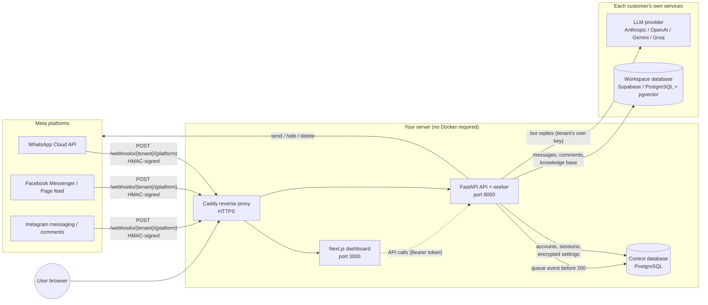

# Synthra CRM

A multi-tenant, self-service CRM for managing AI chatbots on **WhatsApp**, **Facebook** (inbox + comments) and **Instagram** (inbox + comments).

Anyone can register, connect only the channels they want, bring their **own database** (Supabase or any PostgreSQL) and **own LLM key**, and get a private dashboard. Every workspace sees only its own data.

## What you get

- Accounts: register, email verification, login, password reset, rotating refresh tokens in an httpOnly cookie, brute-force lockout, argon2id hashing, server-side session revocation.
- One settings page per channel (WhatsApp inbox, Facebook inbox, Facebook comments, Instagram inbox, Instagram comments) with a test button, status, the exact webhook URL and verify token, and bot behaviour (system prompt, tone, spam/abuse actions, LLM provider).
- Bring-your-own database with automatic setup: versioned, idempotent migrations, a dry-run preview and a migration status page. A manual SQL file is available as a fallback.
- Inbox dashboards (conversations, send, bot on/off per customer, human handoff, media), comment moderation (reply publicly or privately, hide, delete platform-first, bulk delete), a knowledge base (upload, chunking, embeddings, atomic swap), notifications and analytics.
- Durable webhook queue with idempotency, retries, per-workspace rate limits and daily LLM call caps.
- Every stored credential is encrypted with AES-256-GCM. Saved secrets are never sent back to the browser.

## Architecture



Request flow for an incoming message: Meta calls the workspace's webhook URL, the API verifies the HMAC signature with that workspace's app secret, writes the event to the durable queue in the control database, then answers 200. A worker claims the event, loads the workspace database, retrieves relevant knowledge base chunks, asks the workspace's LLM, and sends the reply through the Meta API.

Two databases are involved: the **control database** (yours: accounts, sessions, encrypted settings, the event queue) and one **workspace database per customer** (their own: conversations, comments, knowledge base).

## Repository layout

| Path | Purpose |
| --- | --- |
| `backend/` | FastAPI API, queue worker, bot engine, migrations |
| `frontend/` | Next.js dashboard |
| `deploy/` | systemd units and a Caddyfile for a plain Linux server |
| `docs/` | Guides (see below) |
| `CLAUDE.md` | Project memory: stack, modules, schema, routes, conventions, progress |

## Quick start (local development, no Docker)

You need Python 3.11-3.13, Node.js 20.9+ and a PostgreSQL database for the control plane (a free Supabase or Neon project works, or a local install).

```powershell
# 1. Backend (from synthra-crm/backend)
python -m venv .venv ; .venv\Scripts\Activate.ps1
pip install -r requirements.txt -r requirements-dev.txt
copy .env.example .env
# Fill CRM_DATABASE_URL, CRM_MASTER_KEY, CRM_JWT_SECRET. Generate each key with:
python -c "import os,base64;print(base64.b64encode(os.urandom(32)).decode())"
# CRM_JWT_SECRET only needs 32+ random characters (the same command works).
# Optional for offline work: set CRM_EMBEDDER=hash to skip the ~90 MB model download.
uvicorn app.main:app --reload

# 2. Frontend (from synthra-crm/frontend, new terminal)
copy .env.example .env.local
npm install
npm run typecheck
npm run dev
```

Open http://localhost:3000, register, and follow the setup order in the dashboard: connect your database, then configure a channel.
In development, verification and reset emails are printed to the backend log when SMTP is not configured.

Linux and macOS: use `python3 -m venv .venv && source .venv/bin/activate` and `cp` instead of `copy`.

### Tests

```powershell
cd backend
python -m pytest -q
```

Integration tests need a PostgreSQL with pgvector and are skipped unless `CRM_TEST_DATABASE_URL` is set. `python scripts/dev_postgres.py` starts a throwaway local server (needs Python 3.9-3.12 and `pgserver`).

## Documentation

- [Self-hosting and deployment](docs/self-hosting.md)
- [Environment variable reference](docs/environment.md)
- Channel setup guides: [WhatsApp](docs/channels/whatsapp.md) · [Facebook inbox](docs/channels/facebook-inbox.md) · [Facebook comments](docs/channels/facebook-comments.md) · [Instagram inbox](docs/channels/instagram-inbox.md) · [Instagram comments](docs/channels/instagram-comments.md)
- [Security review (OWASP Top 10)](docs/security-review.md)
- [Production-readiness checklist and your to-do list](docs/production-checklist.md)

## Licence and privacy

Add your licence here. A privacy policy is required by Meta before apps go live; keep it published at a public URL.
